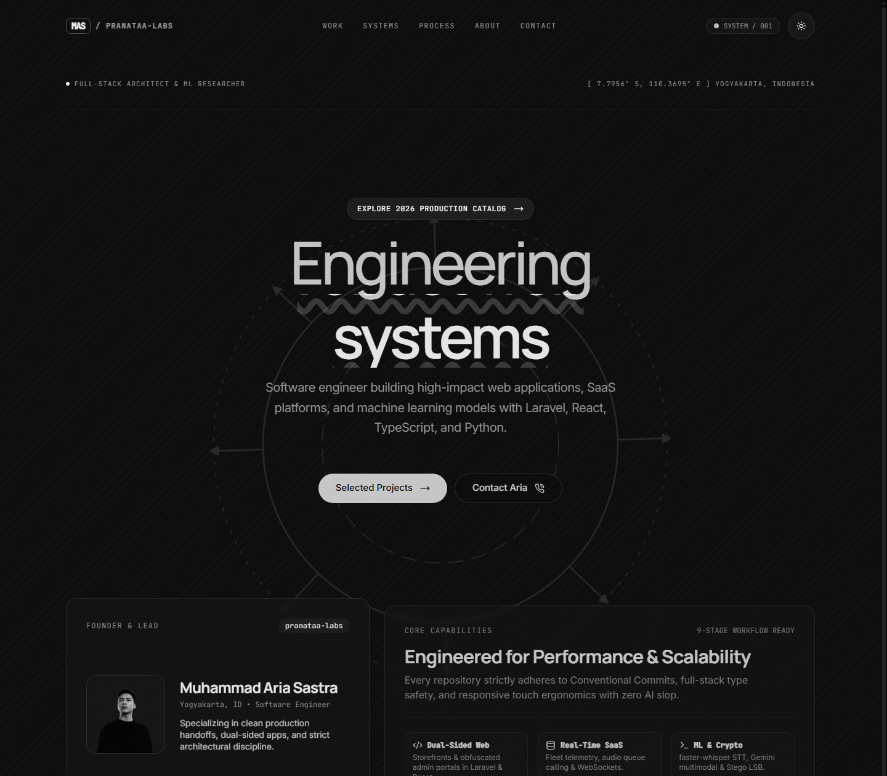
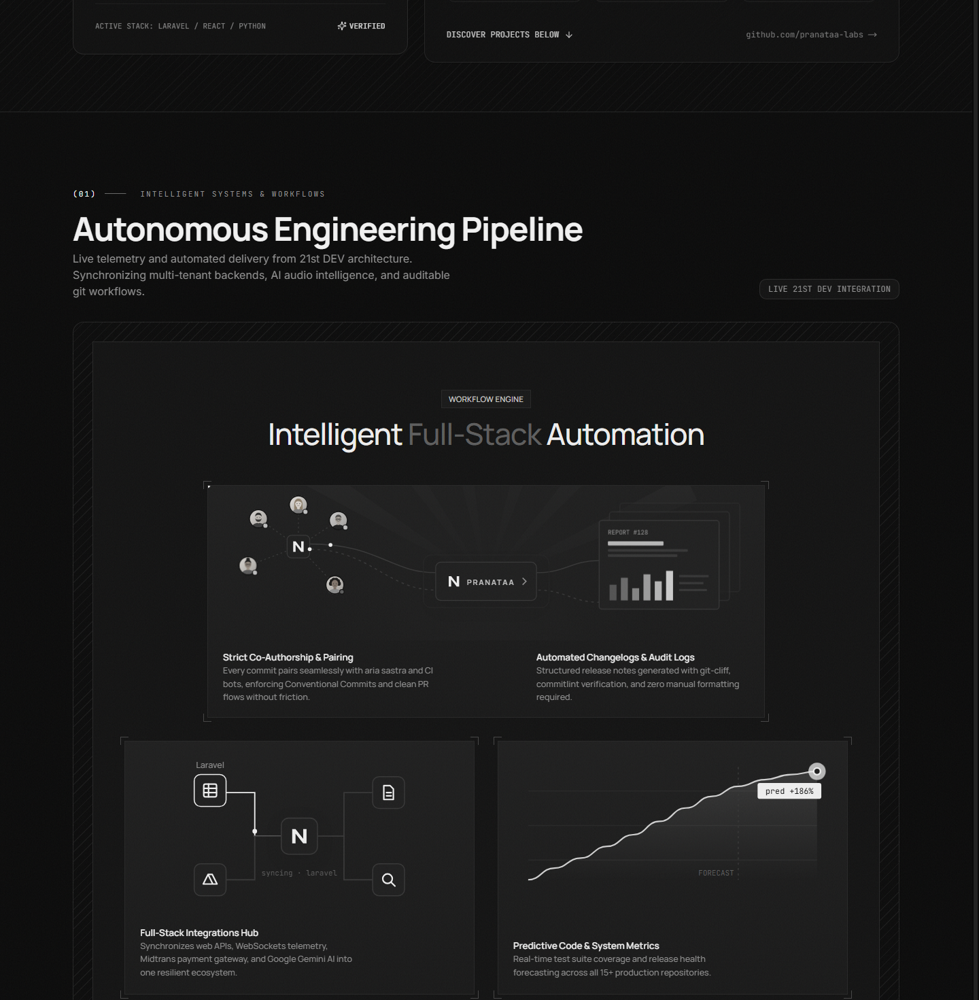
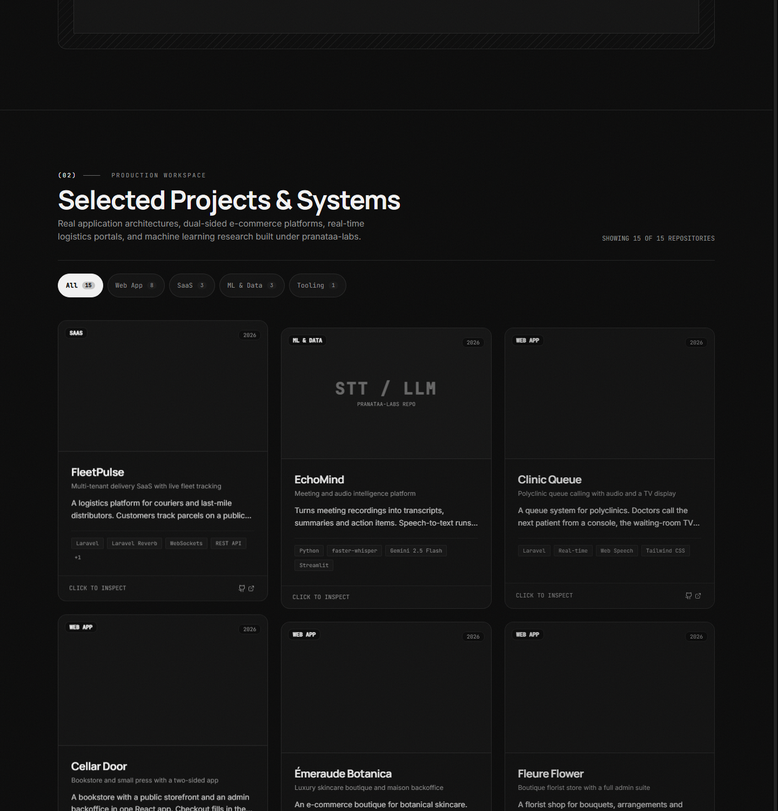
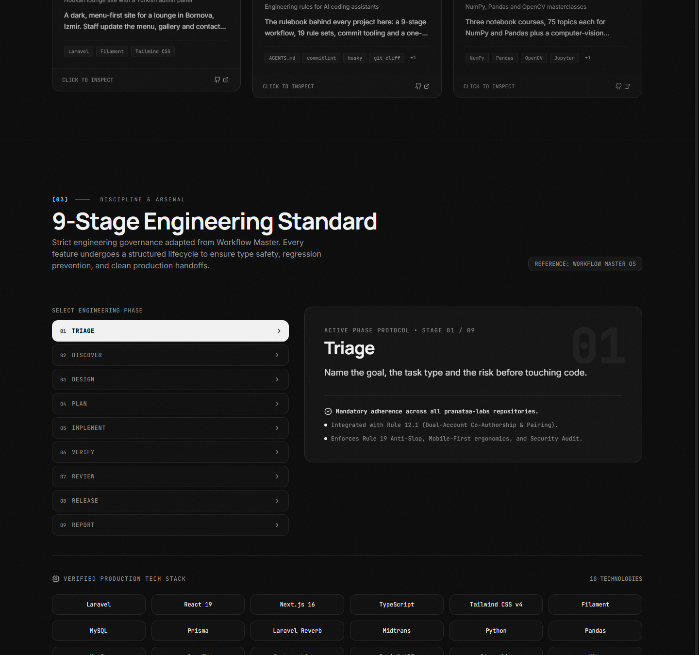
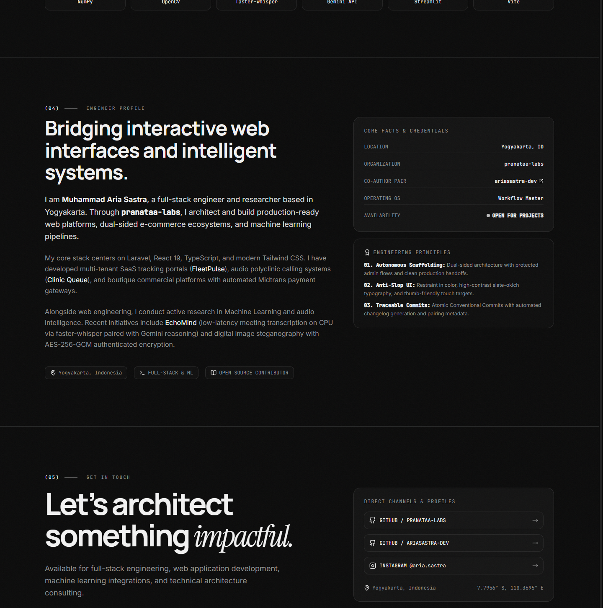
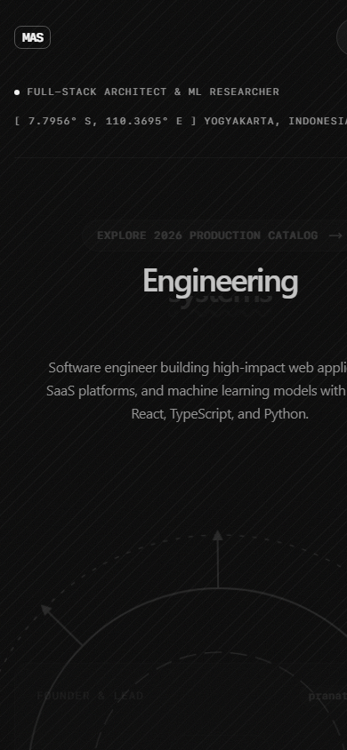

# Personal Engineering Portfolio

[`react`](https://github.com/topics/react) • [`portfolio`](https://github.com/topics/portfolio) • [`typescript`](https://github.com/topics/typescript) • [`developer-portfolio`](https://github.com/topics/developer-portfolio) • [`tailwind`](https://github.com/topics/tailwind) • [`shadcn-ui`](https://github.com/topics/shadcn-ui) • [`framer-motion`](https://github.com/topics/framer-motion) • [`vite`](https://github.com/topics/vite)

An interactive, production-grade monochrome portfolio for **Muhammad Aria Sastra**, showcasing full-stack web applications, multi-tenant SaaS architectures, audio intelligence platforms, and machine learning research developed under **pranataa-labs**.

Engineered with **React 19**, **TypeScript**, **Vite 6**, **Tailwind CSS v4**, and **shadcn-ui**, featuring smooth monochrome physics and animations powered by **21st DEV** and **Framer Motion**.

---

## Application Showcase & Previews

### 1. Interactive Hero & Engineering Spotlight
*Dynamic spring-animated cycling text, rotating Mahoraga motif, coordinate tracking, and verified founder credentials.*



---

### 2. 21st DEV — Ink Orbit Autonomous Engineering Pipeline
*Live telemetry bento box featuring real-time team flow diagrams, multi-tool integration synchronization, and scrubbable test velocity forecast charts.*



---

### 3. Curated Production Projects Gallery
*Interactive showcase of 15+ production repositories across `pranataa-lab` with category filtering (`All`, `Web App`, `SaaS`, `ML & Data`, `Tooling`), architectural breakdown modals, and direct GitHub links.*



---

### 4. 9-Stage Engineering Standard (Workflow Master)
*Interactive protocol visualizer adhering to Workflow Master engineering governance, paired with verified production tech stack badges.*



---

### 5. Profile Biography & Direct Contact Channels
*Authentic engineering biography, core credentials, co-author pairing specifications, 1-click email copy, and social channels.*



---

### 6. Mobile Ergonomics & Responsive Matrix
*Strict thumb zone layout, touch targets $\ge 44 \times 44\text{px}$, drawer navigation, and safe area insets support.*

<div align="center">
  
</div>

---

## Technology Stack & Architecture

- **Core Framework:** React 19 (Strict Mode, Type-Safe Architecture)
- **Language & Runtime:** TypeScript 5.7, Node.js 24
- **Bundler & Tooling:** Vite 6 (`@vitejs/plugin-react`)
- **Styling Engine:** Tailwind CSS v4 (`@tailwindcss/vite`), tw-animate-css
- **Design System:** Pure Neutral OKLCH Tokens (`satnaing/shadcn-admin` inspired), Tactile Film Grain, Circular View-Transition Theme Switch
- **UI Components:** shadcn-ui standard in `/src/components/ui` (`button`, `dialog`, `slot`), Lucide Icons
- **Animation & Physics:** 21st DEV components (`ink-orbit-features`, `animated-hero`), Framer Motion 12, Lenis smooth scrolling
- **Testing & Verification:** TypeScript typecheck, Vitest 3

---

## Project Structure

```text
Aria-Sastra-Portfolio/
├── docs/
│   └── screenshots/              # Real application previews embedded in README
│       ├── 01-hero-monochrome.png
│       ├── 02-21st-dev-ink-orbit.png
│       ├── 03-projects-showcase.png
│       ├── 04-9-stage-workflow-master.png
│       ├── 05-about-and-contact.png
│       └── 05-mobile-responsive-view.png
├── public/
│   ├── projects/                 # Optimized WebP project captures (< 80KB)
│   ├── favicon.svg               # Monogram MAS favicon
│   └── pranataa.webp             # Optimized portrait asset
├── src/
│   ├── components/
│   │   ├── ui/                   # Atomic shadcn-ui & 21st DEV components
│   │   │   ├── animated-hero.tsx # 21st DEV Animated Cycling Hero
│   │   │   ├── button.tsx        # shadcn Button (CVA + Radix Slot)
│   │   │   └── ink-orbit-features.tsx # 21st DEV Live Diagram Bento
│   │   ├── about-section.tsx     # Profil, credentials, & principles
│   │   ├── contact-section.tsx   # Direct email copy, GitHub, Instagram
│   │   ├── custom-cursor.tsx     # Trailing spring cursor with lerp
│   │   ├── hero.tsx              # Hero bento + Mahoraga wheel motif
│   │   ├── ink-orbit-section.tsx # Live pipeline & pairing telemetry
│   │   ├── motion.tsx            # Framer Motion primitives
│   │   ├── navbar.tsx            # Sticky header + circular theme transition
│   │   ├── process-section.tsx   # 9-Stage Workflow Master visualizer
│   │   ├── project-card.tsx      # Interactive project article card
│   │   ├── project-modal.tsx     # Architectural specs dialog
│   │   └── projects-section.tsx  # Dynamic category filtering
│   ├── data/
│   │   └── projects.ts           # 15+ production repositories metadata
│   ├── hooks/
│   │   ├── use-lenis.ts          # Inertial smooth scrolling
│   │   └── use-theme.ts          # View Transitions API theme toggle
│   ├── lib/
│   │   └── utils.ts              # ClassNames merger (clsx + tailwind-merge)
│   ├── App.tsx
│   ├── index.css                 # OKLCH monochrome tokens & base layers
│   └── main.tsx
├── components.json               # shadcn project configuration
├── package.json
├── tsconfig.json
└── vite.config.ts
```

---

## Local Setup & Development

### 1. Repository Cloning
```bash
git clone https://github.com/pranataa-labs/Aria-Sastra-Portfolio.git
cd Aria-Sastra-Portfolio
```

### 2. Install Dependencies
```bash
npm install
```

### 3. Start Development Server
```bash
npm run dev
```
Open `http://localhost:5173/` in your web browser.

### 4. Build for Production & Preview
```bash
npm run build
npm run preview
```

---

## Git Discipline & Co-Authorship Mandate

All commits across this repository strictly adhere to Conventional Commits and include pairing co-authorship:
```text
Co-authored-by: aria sastra <192975116+ariasastra-dev@users.noreply.github.com>
```

---

## License

Open-sourced under the [MIT License](LICENSE).
